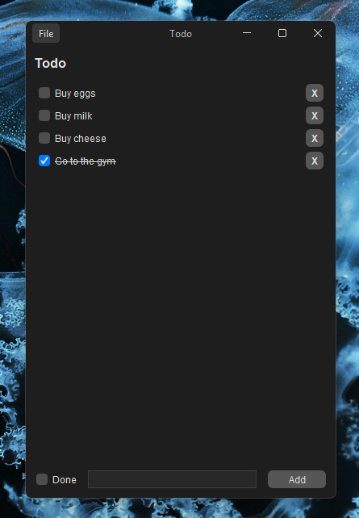

# Kotlin Swing Todo App

A simple Todo app made with Kotlin and Swing

## Requirements

- Java 25
- Kotlin 2.4.21

> [!NOTE]
> You might need to rebuild the project first if you're using IntelliJ IDEA